  

# 🚀 Awesome Marketing Campaign Management 📈

> 🎯 A carefully curated index of industry-leading **Marketing Campaign Management**, **Marketing Automation**, and **Omnichannel Customer Engagement** platforms — featuring both commercial SaaS suites and battle-tested, self-hostable open-source solutions for multi-channel email, SMS, push, in-app messaging, visual journey orchestration, and customer data platforms (CDP).
>
> 🌟 **Star this repository** if you find it helpful! Contributions and feedback are warmly welcomed. 🌟

---

## 📑 Table of Contents

- [📊 Sector Overview & Market Dynamics](#-sector-overview--market-dynamics)
- [🟦 SaaS / Hosted Platforms](#-saas--hosted-platforms)
- [🟩 Open-Source Software](#-open-source-software)
  - [1. Listmonk](#1-listmonk-)
  - [2. Mautic](#2-mautic-)
  - [3. SuiteCRM](#3-suitecrm-)
  - [4. Plunk](#4-plunk-)
  - [5. erxes](#5-erxes-)
  - [6. Dittofeed](#6-dittofeed-)
  - [7. Laudspeaker](#7-laudspeaker-)
  - [8. Notifuse](#8-notifuse-)
  - [9. Keila](#9-keila-)
  - [10. SendPortal](#10-sendportal-)
  - [11. Helio](#11-helio-)
- [📊 Feature Comparison Matrix](#-feature-comparison-matrix)
- [📈 Star History](#-star-history)
- [💖 Support & Sponsorship](#-support--sponsorship)
- [🤝 Contributing](#-contributing)
- [📄 License](#-license)

---

## 📊 Sector Overview & Market Dynamics

The global marketing campaign management and marketing automation market is estimated between **$13B–$15B** (focused campaign management software) and over **$40B+** (broad enterprise marketing automation ecosystem), expanding at a rapid **11%–15% CAGR**. 

The sector displays a distinct **bifurcated market structure**:
* **Enterprise Tier (Highly Concentrated / Oligopoly-leaning):** Dominated by legacy enterprise suites (**Adobe / Marketo**, **Salesforce Marketing Cloud**, and **HubSpot**). These platforms capture massive aggregate revenue by leveraging deep CRM/ERP platform lock-in, proprietary data lakes, and steep switching costs.
* **Mid-Market & SMB Tier (Highly Fragmented):** Populated by agile specialist tools (**Klaviyo** in e-commerce, **Braze** and **Customer.io** in event-driven mobile/PLG engagement) alongside hundreds of lightweight niche and self-hosted open-source alternatives. These competitors win on transparent developer-friendly pricing, privacy sovereignty, and rapid time-to-value without heavy onboarding lock-in.

---

## 🟦 SaaS / Hosted Platforms

Commercial, cloud-hosted Marketing Campaign Management and customer engagement suites. These platforms are fully managed, cloud-native services benchmarked here for feature, scalability, and pricing comparison.

| 🏢 Platform | 🎯 Type / Core Focus | 💼 Company Size (Valuation / Revenue) | 🏷️ Starting Tier Pricing | 🎁 Free Tier / Free Trial Limits | ⚡ Key Capabilities |
| :--- | :--- | :--- | :--- | :--- | :--- |
| **[Marketo Engage](https://business.adobe.com/products/marketo/adobe-marketo.html)** (Adobe) | Enterprise B2B marketing automation & lead nurturing | **$94.6B+** Market Cap (Adobe Inc.) / ~$25.9B Revenue ($4.75B acquisition) | **$895/month** (Growth tier, billed annually; ~20k contacts) | **No free tier or trial** (Guided sales demo walkthrough only) | Lead scoring, multi-touch attribution, ABM, enterprise campaign orchestration, deep CRM sync |
| **[HubSpot Marketing Hub](https://www.hubspot.com/products/marketing)** | All-in-one inbound marketing & CRM suite | **~$10.6B** Market Cap / ~$2.6B+ Trailing Revenue | **$15/month** (billed annually, $20/mo monthly; Starter tier, 1,000 marketing contacts, 1 seat) | **Free Forever** (Up to 1,000 non-marketing contacts, basic forms, email marketing with HubSpot branding) | Visual drag-and-drop builder, landing pages, lead forms, email automations, native CRM integration, reporting |
| **[Klaviyo](https://www.klaviyo.com/)** | E-commerce marketing automation & lifecycle messaging | **~$6.1B** Market Cap / ~$1.47B Trailing Revenue | **$20/month** (Base Email plan; up to 500 active profiles, 5,000 email sends/month) | **Free Forever** (Up to 250 active profiles, 500 email sends/month, 150 SMS credits, Klaviyo branding, 60 days email support) | E-commerce behavioral triggers, deep Shopify/WooCommerce sync, revenue attribution, multi-channel messaging |
| **[Braze](https://www.braze.com/)** | Enterprise cross-channel customer engagement platform | **~$5.3B** Market Cap / ~$834M Trailing Revenue | **~$2,500/month** (~$30,000/year base entry annual contract) | **14-day free trial** (Sales-assisted demo trial access to product tours and test campaigns; no permanent free tier) | Real-time journey orchestration, mobile push, in-app messaging, SMS, email, event streaming |
| **[ActiveCampaign](https://www.activecampaign.com/)** | Customer experience automation with integrated SMB CRM | **$3.0B** Valuation (Series C) / ~$200M–$290M ARR | **$15/month** (billed annually, $19/mo monthly; Starter plan, up to 1,000 contacts) | **14-day free trial** (1 user seat, capped at 100 email sends total, access to Professional features; no permanent free tier) | Visual automation builder, contact tracking, email marketing, CRM pipeline, site messaging |
| **[Customer.io](https://customer.io/)** | Behavioral event-triggered messaging platform | **$400M+** Est. Valuation / ~$100M+ ARR | **$100/month** (billed monthly; Essentials plan, up to 5,000 profiles, 1M emails/month) | **14-day free trial** (Up to 5,000 test messages across channels, 50 daily test email sends cap; no permanent free tier) | Event-driven journeys, multi-channel workflows (email, SMS, push, in-app), webhooks, data pipelines |

---

## 🟩 Open-Source Software

Self-hosted, community-driven, and developer-friendly marketing campaign management systems. The open-source ecosystem offers complete data sovereignty, zero per-seat fees, and direct database access. 

The repositories below are **sorted in descending order by GitHub Stars**:

### 1. [Listmonk](https://github.com/knadh/listmonk) 
* **Stack:** Go / PostgreSQL | **License:** AGPL-3.0
* **Overview:** High-performance, self-hosted newsletter and mailing list manager with a sleek admin interface. Designed to pack multi-million subscriber handling into a single lightweight binary with minimal overhead.
* **Key Features:**
  - ⚡ Blazing fast email throughput (thousands of emails per second)
  - 📋 Multi-list management and dynamic subscriber attributes
  - 🎨 HTML and Markdown template editing with live preview
  - 🔌 RESTful APIs and webhook integrations
* **Best For:** Developers and businesses seeking high-volume email newsletters without SaaS subscription tax.

### 2. [Mautic](https://github.com/mautic/mautic) 
* **Stack:** PHP / MySQL | **License:** GPL-3.0
* **Overview:** The world's flagship open-source marketing automation platform, delivering enterprise-grade lead nurturing, GDPR compliance, and visual customer journeys.
* **Key Features:**
  - 🗺️ Visual drag-and-drop campaign journey builder with conditional logic
  - 📊 Multi-channel delivery: Email, SMS, web push, and browser notifications
  - 🎯 Advanced lead scoring, contact stages, and visitor tracking
  - 🛡️ Strict GDPR consent tracking, data auditing, and complete data ownership
  - 👥 Unlimited seats and contacts with zero per-contact fees
* **Critical Note:** Requires a properly scheduled background cron worker to fire timed campaign events.
* **Best For:** Teams and enterprises demanding a full-featured, self-hosted alternative to HubSpot and Marketo.

### 3. [SuiteCRM](https://github.com/salesagility/SuiteCRM) 
* **Stack:** PHP / MariaDB / MySQL | **License:** AGPL-3.0
* **Overview:** The open-source enterprise standard alternative to Salesforce. Houses an extensive marketing campaign suite directly tied to customer accounts, sales opportunities, and pipelines.
* **Key Features:**
  - 📨 Multi-channel campaign wizard with automated target list segmentation
  - 📈 Email template creation, tracker URLs, and campaign ROI analytics
  - 🔄 Lead capture web-to-lead forms with automatic sales team routing
  - 🏢 End-to-end CRM integration spanning Marketing, Sales, and Support
* **Best For:** Enterprises needing integrated marketing campaign execution built directly into their core open-source CRM.

### 4. [Plunk](https://github.com/useplunk/plunk) 
* **Stack:** TypeScript / Node.js / PostgreSQL / AWS SES | **License:** AGPL-3.0 / Open Source
* **Overview:** Modern, developer-centric email platform combining transactional delivery, marketing broadcast campaigns, and automated sequences in a unified API.
* **Key Features:**
  - 📬 Unified engine for transactional, marketing broadcasts, and triggered emails
  - ⚡ AWS SES native routing for optimal deliverability and ultra-low sending costs
  - 🧩 Visual automation workflow builder for drip sequences and lifecycle emails
  - 🛠️ Developer-first SDKs, webhooks, and REST endpoints
* **Best For:** SaaS startups and developers looking for a self-hosted alternative to Resend, SendGrid, and Mailchimp.

### 5. [erxes](https://github.com/erxes/erxes) 
* **Stack:** Node.js / React / MongoDB | **License:** AGPL-3.0 (Community Edition)
* **Overview:** Open-source Experience Operating System (XOS) combining marketing campaigns, live chat, sales pipelines, and customer support into one collaborative interface.
* **Key Features:**
  - 💬 Omnichannel Team Inbox connecting live chat, email, SMS, and forms
  - 🧲 Lead capture popups, responsive landing pages, and embeddable forms
  - 🚀 Engage module for automated multi-channel marketing campaigns
  - 📊 Visual sales pipelines, deal funnels, and CRM contact profiles
* **Best For:** SMBs looking for an open-source HubSpot alternative that aligns marketing campaigns with real-time support and sales.

### 6. [Dittofeed](https://github.com/dittofeed/dittofeed) 
* **Stack:** TypeScript / Node.js / Temporal / ClickHouse / PostgreSQL | **License:** MIT
* **Overview:** Event-driven, open-source customer engagement platform built for growth engineering teams. Engineered with Temporal for resilient journey workflows at scale.
* **Key Features:**
  - 🔄 Durable, stateful journey orchestration powered by Temporal
  - 📡 Behavioral event tracking and dynamic user cohort segmentation
  - 📱 Cross-channel messaging: Email, SMS, mobile push, and custom webhook actions
  - ⚡ High-throughput event ingestion and real-time behavioral triggers
* **Best For:** Growth engineers and product teams wanting an open-source, code-friendly alternative to Customer.io and Braze.

### 7. [Laudspeaker](https://github.com/laudspeaker/laudspeaker) 
* **Stack:** TypeScript / Node.js / PostgreSQL | **License:** Open Source (Y Combinator-backed)
* **Overview:** YC-backed open-source customer journey orchestration engine designed as a self-hostable alternative to Braze and Iterable.
* **Key Features:**
  - 🧭 No-code visual canvas for building complex customer journeys
  - 📩 Multi-channel support across Email, SMS, Push notifications, and Slack
  - ⏱️ Intelligent time delays, conditional wait windows, and event forks
  - 🔌 Seamless integrations with PostHog, Segment, and PostgreSQL databases
* **Best For:** Product-led companies needing visual cross-channel journey building backed by product analytics.

### 8. [Notifuse](https://github.com/Notifuse/notifuse) 
* **Stack:** Go / React / PostgreSQL | **License:** Open Source
* **Overview:** Modern, self-hosted newsletter and marketing automation suite featuring a visual MJML email designer and multi-provider delivery.
* **Key Features:**
  - 🎨 Drag-and-drop MJML email builder with live mobile/desktop preview
  - 🔀 Automation flow editor with delay, conditional branch, and A/B test nodes
  - 🌐 Multi-provider failover support (Amazon SES, Postmark, Mailgun, SendGrid)
  - 📊 Cookieless, GDPR-compliant web analytics and subscriber tracking
* **Best For:** Marketers and developers seeking a clean, modern email marketing system with multi-provider redundancy.

### 9. [Keila](https://github.com/pentacent/keila) 
* **Stack:** Elixir / Phoenix / PostgreSQL | **License:** AGPL-3.0
* **Overview:** Fast, privacy-first newsletter and campaign tool built with Elixir. Focuses on data security, clean UI, and effortless contact segmentation.
* **Key Features:**
  - 🔒 Privacy-first analytics without intrusive third-party user tracking
  - 📝 Block-based visual email editor and raw markdown support
  - 🎯 Flexible contact tagging and dynamic segment filtering
  - 📤 Reliable mail delivery via custom SMTP or Amazon SES
* **Best For:** Privacy-conscious creators, publications, and businesses needing a dependable newsletter manager.

### 10. [SendPortal](https://github.com/mettle/sendportal) 
* **Stack:** PHP / Laravel / PostgreSQL / MySQL | **License:** MIT
* **Overview:** Open-source email marketing platform built on Laravel. Features multi-tenant workspaces and seamless integrations with popular ESPs.
* **Key Features:**
  - 🏢 Multi-tenant architecture for handling multiple workspaces and brands
  - 📊 Campaign analytics including open rates, click-through rates, and bounces
  - 📬 Native ESP integrations with Amazon SES, Mailgun, SendGrid, and Postmark
  - 🏷️ Subscriber segment management with custom field attributes
* **Best For:** Agencies, developers, and Laravel teams looking for a customizable email campaign management codebase.

### 11. [Helio](https://github.com/achref-soua/helio) 
* **Stack:** TypeScript / Temporal / PostgreSQL / ClickHouse | **License:** AGPL-3.0
* **Overview:** Next-generation AI-native growth platform combining an embedded CDP, visual journey orchestration, and AI-assisted campaign drafting.
* **Key Features:**
  - 🤖 AI Copilot for generating journeys, copy, and audience segments from prompts
  - 🛠️ Model Context Protocol (MCP) server enabling external AI agents to trigger actions
  - 📱 Omnichannel delivery: Email, SMS (Twilio), WhatsApp, and Web Push
  - ⏳ Durable execution engine powered by Temporal
* **Best For:** Engineering teams looking to pioneer AI-agentic marketing automation and automated growth workflows.

---

## 📊 Feature Comparison Matrix

| 🛠️ Software | 📜 License | 💻 Core Tech Stack | 🎨 Visual Builder | 📲 Multi-Channel | 🏠 Self-Hosted | 🌟 Primary Strength |
| :--- | :--- | :--- | :---: | :---: | :---: | :--- |
| **Marketo Engage** | Proprietary | Cloud | ✅ | ✅ | ❌ | Enterprise B2B multi-touch attribution |
| **HubSpot** | Proprietary | Cloud | ✅ | ✅ | ❌ | All-in-one Inbound Marketing & CRM |
| **Klaviyo** | Proprietary | Cloud | ✅ | ✅ | ❌ | DTC e-commerce behavioral automation |
| **Braze** | Proprietary | Cloud | ✅ | ✅ | ❌ | Enterprise mobile & cross-channel journeys |
| **ActiveCampaign** | Proprietary | Cloud | ✅ | ✅ | ❌ | SMB automation workflows & lightweight CRM |
| **Customer.io** | Proprietary | Cloud | ✅ | ✅ | ❌ | Event-triggered messaging for PLG SaaS |
| **Listmonk** | AGPL-3.0 | Go / PostgreSQL | ❌ (Templates) | ❌ (Email only) | ✅ | Ultra-fast, high-volume newsletter delivery |
| **Mautic** | GPL-3.0 | PHP / MySQL | ✅ Full Journey | ✅ Email, SMS, Web Push | ✅ | Enterprise OSS maturity & complete data ownership |
| **SuiteCRM** | AGPL-3.0 | PHP / MySQL | ✅ Wizard | ✅ Email & Web Forms | ✅ | Full CRM integration with campaign workflows |
| **Plunk** | AGPL-3.0 | TS / AWS SES | ✅ Automations | ❌ (Email focus) | ✅ | Developer-first transactional + marketing email |
| **erxes** | AGPL-3.0 | Node.js / React | ✅ Sales Funnels | ✅ Email, SMS, Chat | ✅ | Integrated marketing, CRM & team support inbox |
| **Dittofeed** | MIT | TS / Temporal | ✅ Journeys | ✅ Email, SMS, Push | ✅ | Resilient event-driven growth orchestration |
| **Laudspeaker** | Open Source | TypeScript / Node | ✅ Visual Canvas | ✅ Email, SMS, Push, Slack | ✅ | YC-backed open-source alternative to Braze |
| **Notifuse** | Open Source | Go / React / MJML | ✅ MJML + Flow | ❌ (Email focus) | ✅ | Modern self-hosted email with provider failover |
| **Keila** | AGPL-3.0 | Elixir / Phoenix | ❌ (Blocks) | ❌ (Email focus) | ✅ | Clean, privacy-first newsletter management |
| **SendPortal** | MIT | PHP / Laravel | ❌ (Templates) | ❌ (Email focus) | ✅ | Multi-tenant email marketing for Laravel devs |
| **Helio** | AGPL-3.0 | TS / Temporal | ✅ React Flow | ✅ Email, SMS, WhatsApp | ✅ | AI-native copilot with MCP tool capabilities |

---

## 📈 Star History

---

## 💖 Support & Sponsorship

If you find this repository valuable for your research, team, or projects, please consider supporting the project:

- ⭐ **Star this repository** to help others discover it on GitHub.
- 🍴 **Fork it** to contribute new tools or adapt it for your team.
- 📢 **Share it** on social platforms, newsletters, or tech communities.
- ☕ **Sponsor & Buy a Coffee:** You can sponsor ongoing maintenance and development via the [GitHub Sponsor Dashboard](https://github.com/sponsors/ishandutta2007). Your support is deeply appreciated!

---

## 🤝 Contributing

Contributions are warmly welcome! If you know of an awesome Marketing Campaign Management platform (SaaS or open-source) that should be included:

1. Fork this repository.
2. Create a new branch: `git checkout -b add-tool-name`.
3. Add the platform with details matching the existing structure (Stack, License, Key Capabilities, and GitHub links).
4. Commit your changes: `git commit -m 'Add Tool Name'`.
5. Push to the branch and open a Pull Request.

Please ensure that any submitted open-source repository is actively maintained with releases within the last 12 months.

---

## 📄 License

This compilation is released under the [Creative Commons Zero v1.0 Universal](LICENSE) (CC0 1.0 Universal - Public Domain Dedication). All linked software packages, logos, and trademarks belong to their respective creators and organizations.
